# zWorkTracker

[](https://github.com/rustcircle/z-work-tracker/actions/workflows/ci.yml)

A desktop app for Windows 11 that accounts for labor hours by project and task. It logs start and end times automatically in UTC, shows them on a timeline in any time zone, works out billable time and earnings, analyses how the time was spent, and exports to Excel and CSV.

It runs locally. It makes no network calls and sends no telemetry. Data leaves the machine only if you choose a OneDrive or Google Drive folder for sync.

Status: phase 2 build. It has been run and tested on macOS, and the Windows installer has been built, but the only thing to run on Windows so far is a CI run of the test gates: **the app itself has never run on real Windows**, and that CI run predates phase 2. See [Known limitations](#known-limitations).

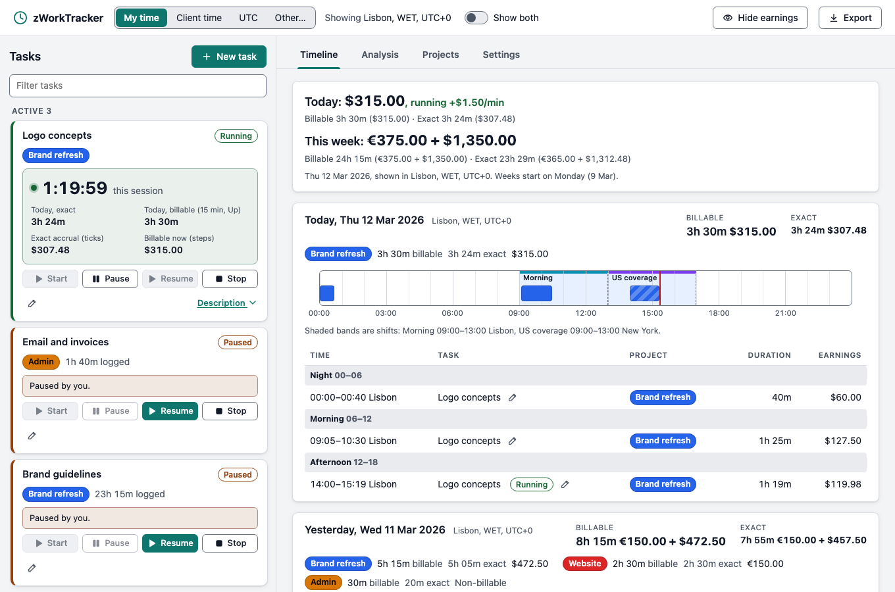

## Contents

- [Install and uninstall](#install-and-uninstall)
- [User guide](#user-guide)
- [Metrics reference](#metrics-reference)
- [Data and privacy](#data-and-privacy)
- [Developer guide](#developer-guide)
- [Performance](#performance)
- [Packaging and signing](#packaging-and-signing)
- [Troubleshooting](#troubleshooting)
- [Known limitations](#known-limitations)
- [Roadmap](#roadmap)
- [Third-party data licences](#third-party-data-licences)
- [Code signing policy](#code-signing-policy)
- [Licence](#licence)

## Install and uninstall

**Install.** Run `zWorkTracker_0.1.0_x64-setup.exe`. It installs for the current user in `%LOCALAPPDATA%\zWorkTracker` and needs no admin rights. It adds a Start Menu shortcut, offers a desktop shortcut and can launch the app when it finishes. Upgrading installs over the old version and keeps your data.

The installer is **not signed yet**, so Windows SmartScreen may say "Windows protected your PC". To continue, choose **More info**, then **Run anyway**. Signing removes that warning over time; see [signing](#windows-code-signing).

**What the app needs from Windows.** It needs one thing: the Microsoft Edge WebView2 Runtime that comes with Windows 11. The app ships no runtime and never downloads one. If WebView2 is missing or disabled, both the installer and the app say so instead of opening a blank window. Everything else is inside the app: JavaScript, map data, time zone data, chart code and icons.

**Uninstall.** Use **Settings > Apps > Installed apps**. A running copy, even one hidden in the tray, is first asked to quit normally, so an open work segment closes cleanly. Uninstalling removes program files, shortcuts, registry entries and the "Start with Windows" entry.

The uninstaller asks **Also delete my time data**, unticked by default, so your data stays unless you tick it. It never touches your OneDrive or Google Drive folders.

## User guide

### First-run setup

A fresh store opens a full-page setup: Welcome; theme with a live preview; My zone and Client zone; time rules (15 minutes Up, with a plain table); a first project; work shifts from presets; sync, showing detected OneDrive and Google Drive folders with checkboxes where nothing is on without a tick; Start with Windows, off by default; and a summary. Every step has Back and Skip, and **Finish with defaults** ends it in one click. Each step saves through the normal settings, an interrupted setup resumes where it stopped, and no time is logged.

On a second PC, where a detected folder already holds data, it offers to connect first and previews the counts. It then skips what the merged data answers and still asks what belongs to this device. If you already used the app, you won't see it. **Run setup again** in Settings changes settings only after you confirm and never touches your data. The old one-time sync and client zone prompts now appear only for someone who updated and still owes them.

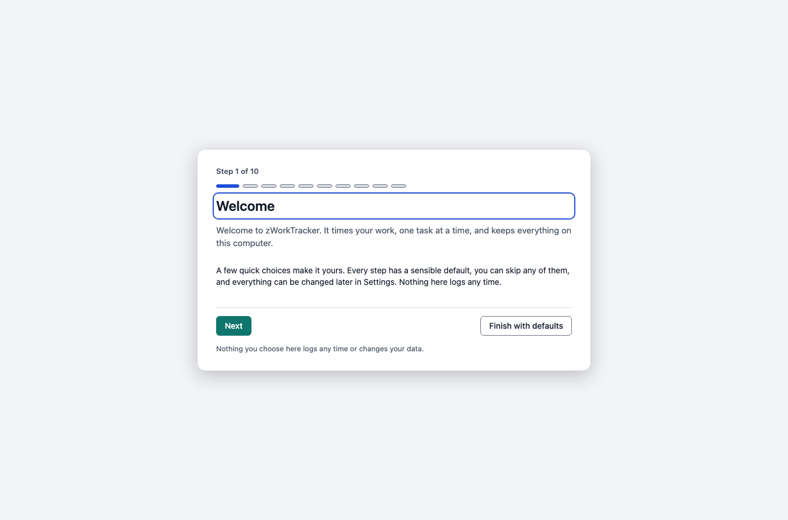

### Projects, price per hour and currency

In **Projects**, create a project with a unique name and a colour. A free colour is suggested, and you can pick your own. A project with tasks can be archived but not deleted; one with no tasks can be deleted. Archived projects can be restored.

**Price per hour** takes EUR (€) or USD ($). Blank means no rate, which differs from 0: a blank project shows "No rate set", while a 0 rate is a real 0. A new price applies from now, so past earnings don't change. To backdate one, choose a date and confirm it. A work segment that crosses a price change is split at that moment. Turning off **billable** means the project earns nothing.

### Tasks and subtasks

Each task has a name, a project and a rich-text description with bold, italic, headings, numbered and bulleted lists and task lists, which is where subtasks and steps go.

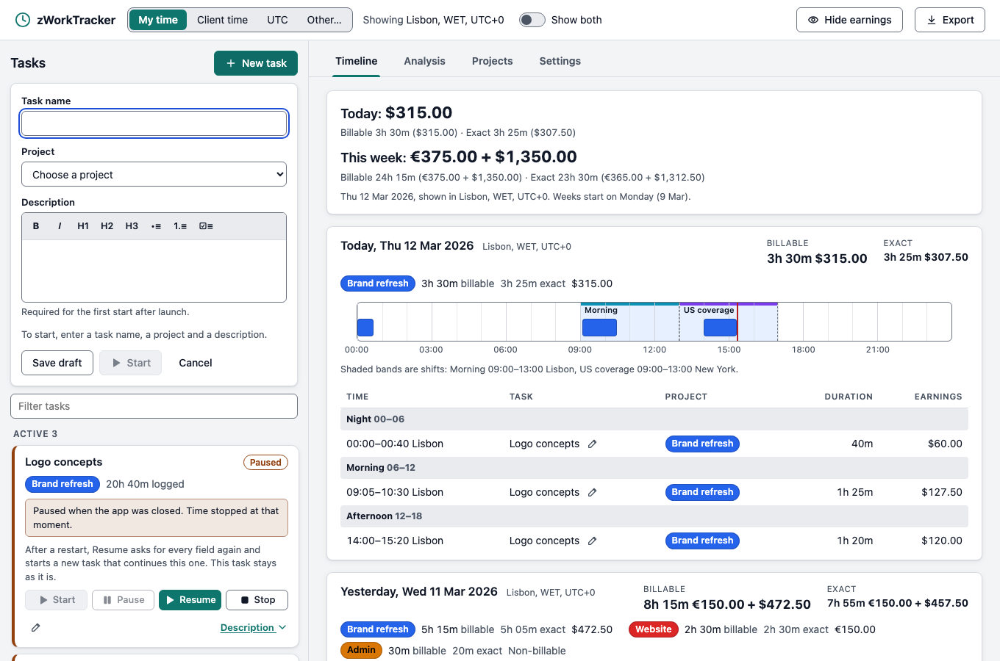

**Starting work: cold and warm.** What the new task form asks depends on whether the app has already logged work since it was launched.

| | Cold | Warm |
|---|---|---|
| **When** | A real launch: boot, tray Quit then reopen, or after a crash. Stays cold until the first task of this launch has started | The app has stayed running since then, even hidden in the tray. Showing the window from the tray or a second launch stays warm |
| **Form** | Empty, nothing filled in | Filled with a copy of the most recently worked task, including paused or stopped ones, with a "Copied from" note |
| **Required** | Name, project and a description with real text. Spaces alone don't count | Name and project. The description may be blank |

The backend enforces these rules, not only the form. A warm copy is a separate task: editing it never changes the original. If the original's project has been archived, you choose another project first, and the form says why.

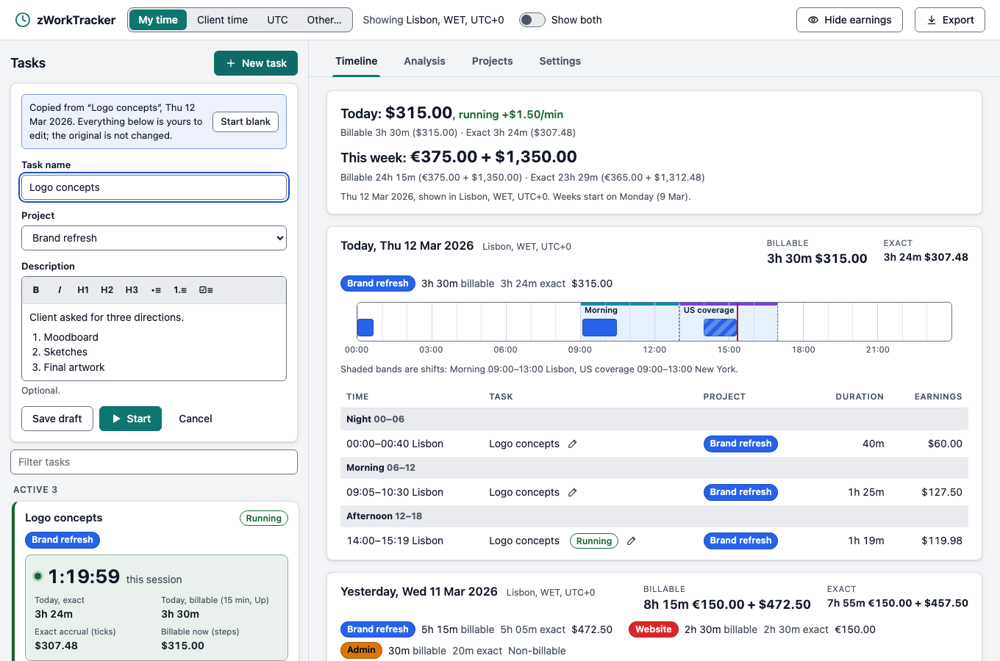

**Editing at any time.** Name and description can be edited in one click from Timeline entries and task details, in every state, including running and stopped. Edits save automatically, and when you leave the field, hide the window or quit. They never touch the timer or the logged time. A blank name isn't saved: the last valid name stays and the field says why. A description can be cleared after the task has started. Timeline, Analysis and exports always show the current values.

### Start, Pause, Resume, Stop

| State | Buttons enabled |
|---|---|
| Draft | Start |
| Running | Pause, Stop |
| Paused | Resume, Stop |
| Stopped | None; stopped is final |

Every Start or Resume opens a work segment and every Pause or Stop closes it. Times come only from the backend clock and are stored in UTC. Paused time is excluded from the total.

**Resume after a relaunch.** On a cold launch, Resume doesn't continue the task directly, and the backend refuses it. It opens the same empty form, with every field required. Submitting creates a **new task linked to the paused one** and starts timing it. The paused task keeps its name and description, stays paused, can still be stopped, and shows a link to its continuation. Cancel changes nothing and logs no time. Once a task has started in this launch, Resume works directly again.

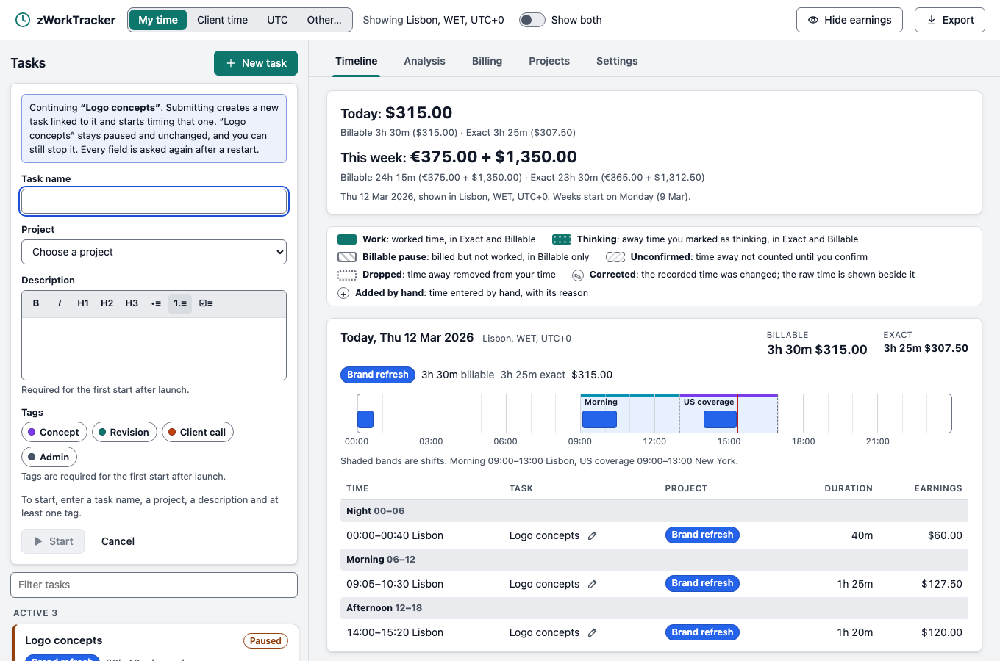

**Continued tasks.** Warm copies and cold continuations are each their own task, linked in task details. They count separately, and each one rounds separately, so a chain of continued tasks can round up more than once in a day. The rounding adjustment metric shows the effect.

Only one task runs at a time on a device. Starting or resuming another task pauses the running one, and the app says so on screen and on the paused task.

### Tray behaviour

Closing the window with X hides it to the tray. **The app keeps running and a running task keeps timing.** The first time this happens, a notice explains it, because Windows 11 may tuck the icon into the overflow area.

- Left-click the tray icon to show the window.
- The menu has Show, the current task with its elapsed time, Pause or Resume, and Quit. On a cold launch, tray Resume opens the window with the form and starts nothing.
- Elapsed time in the tray is h:mm, with no seconds. The tray's text changes only when that minute or your data changes, and the amount is worked out again only when a billing step is due or your data changes. It can lag by up to a minute after a change the app makes by itself, without you doing anything in it.
- The tooltip shows the running task or "No task running". The icon changes shape while a task runs: an open stopwatch when idle, a filled one with a play mark when running.

Only the tray's **Quit** really exits. On a real exit a running segment closes at that moment and the task is marked paused. Opening the app again while it runs brings up the existing window. **Start with Windows** is an optional setting, off by default.

If the app crashes, a heartbeat saved about every 30 seconds marks the last moment it was alive. At the next launch the open segment closes at that moment, the task is paused and a notice tells you, including that the next start asks for every field.

**Time away.** While a task runs, the app watches for gaps: the machine slept, the wall clock jumped by more than two minutes between checks, the session was locked, or nobody touched the keyboard or mouse for the idle limit (10 minutes by default; 0 turns idle detection off, but a sleep, clock jump or lock is always noticed). The app checks for a lock every few seconds on Windows, so the gap's ends can be a few seconds off, and a lock of 10 seconds or less can't be measured and stays work. If Windows stops answering during a lock, the gap closes after a minute at the last moment it confirmed the lock, and idle and sleep detection take over. When you return, the app asks what to do with the time:

| Answer | Exact | Billable and earnings |
|---|---|---|
| No answer yet | Doesn't count | Doesn't count |
| **Keep** | Counts | Counts |
| **Drop** | Doesn't count | Doesn't count |
| **Thinking** | Counts, reported separately | Counts, reported separately |

Raw UTC timestamps stay as they were, whatever you answer. An absence in progress when a segment closes, whether by Pause, Stop, Quit or a crash, is recorded the same way. This replaces the first build's behaviour, where sleeping time counted as work.

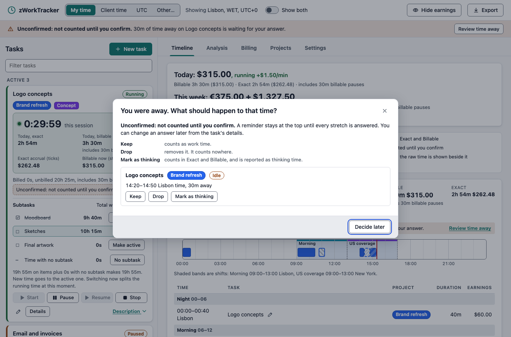

**Reminders.** A notification tells you when a task has run a long time (4 hours by default) or is still running after your shift ended. Both can be turned off, and a reminder can be snoozed. Snoozing doesn't pause anything.

### Timeline

The main screen. It shows the period total at the top, then days with the newest first. Each day has an axis of its real length with blocks in project colours, then entries grouped into Night (00-06), Morning (06-12), Afternoon (12-18) and Evening (18-24). A segment crossing midnight is split across days and bands. Each day header shows Billable and Exact totals plus per-project totals with earnings.

The running task's elapsed clock ticks every second. That is the only figure that does. Earnings everywhere show the **Billable** amount, which moves only when billable time steps at your increment, 15 minutes rounded Up by default. So with rounding Up the first increment shows as soon as work starts on that task-day, and with the increment Off the amount follows exact time. Paused time doesn't move it, and there is no countdown to the next step. The tick stops updating the screen while the window is hidden. Exact amounts appear only in Segment details of an Excel export, labelled, for reconciliation.

**Selecting entries.** A click on a Timeline entry selects it; it doesn't open anything. Ctrl+click (Cmd on macOS) toggles an entry, and Shift+click selects the run from the last one you clicked, across days. By keyboard: Space selects, Ctrl+Space toggles, Shift+Arrow extends, Ctrl+A selects what's visible, and Esc clears. Details and editing keep their own buttons on the row, one click away. An entry stands for one task on one day, the same as a row in Excel, so selecting one row selects every row of that task-day, and a task spanning several days can be partly selected. The selection bar shows the count and total Billable, masked by Hide earnings, with Export selected and Clear. A selection survives scrolling and filter changes, and the bar says when a filter hides some of it.

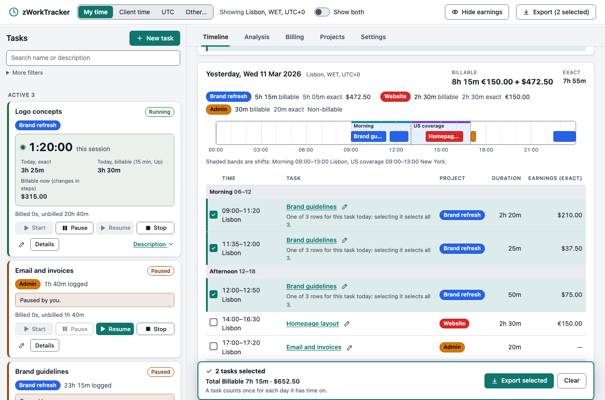

**Filtering tasks.** The task list and the Timeline share one filter: text matched against the name and description, ignoring case and accents and including list items, combined with project and tags. It shows the match count and a clear button, and is forgotten when you quit. Analysis has the same text search among its filters.

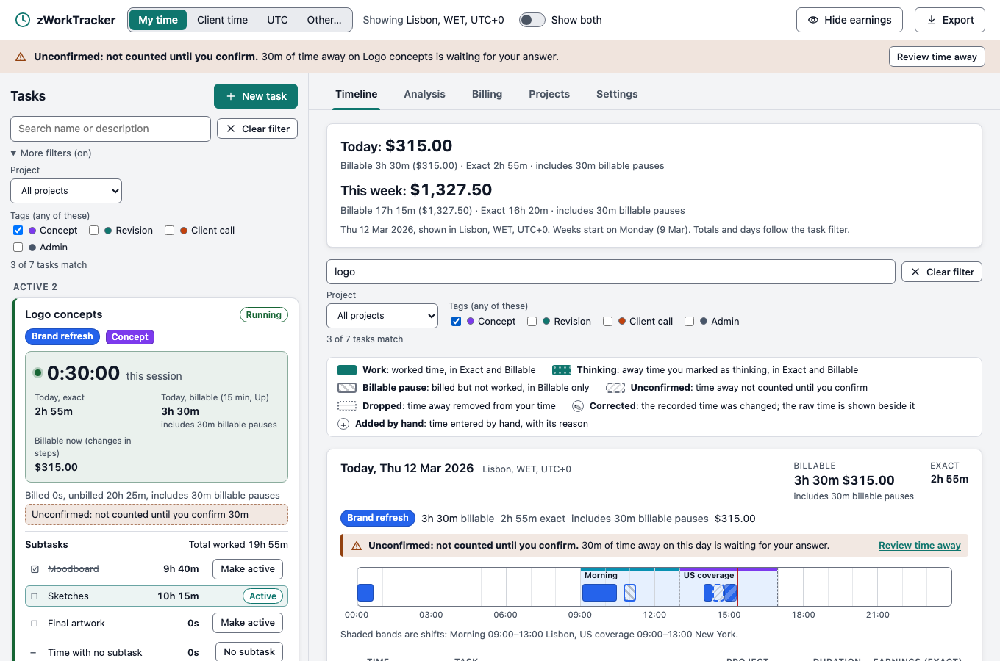

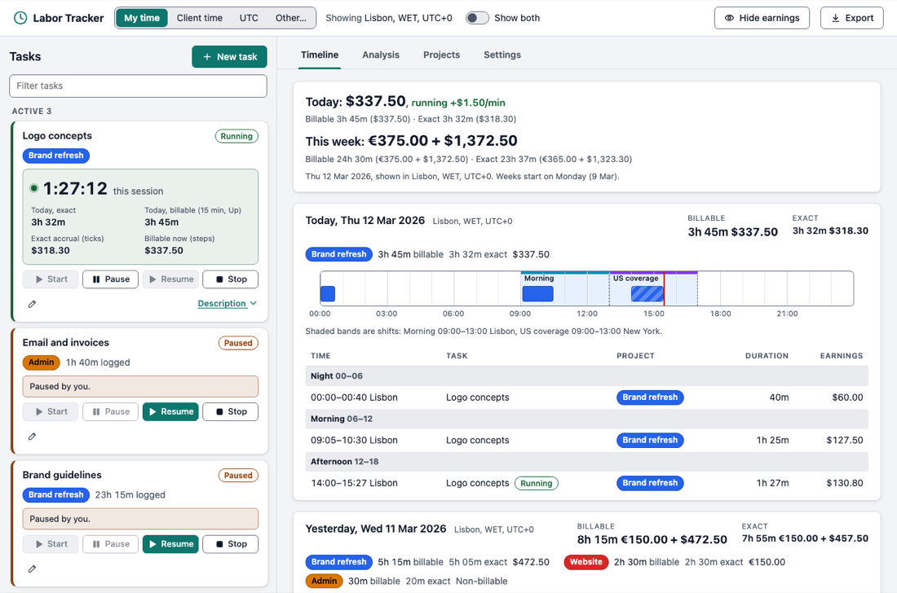

### Analysis

A chart-first dashboard with day, week, month, quarter, year and custom ranges, filters by project, task, band and shift, and a comparison with the previous equal period. Sections cover volume, time of day, projects, tasks, focus and sessions, consistency, goals and money, forecast, shifts and zones. Every chart has a **View data** table and tooltips with exact values, and clicking a chart drills down to the tasks and segments behind it.

Each metric has an info popover and an entry in the searchable Metrics glossary. Written Insights are generated from the numbers, with no AI. There's no productivity score: logged time measures logged time, not output.

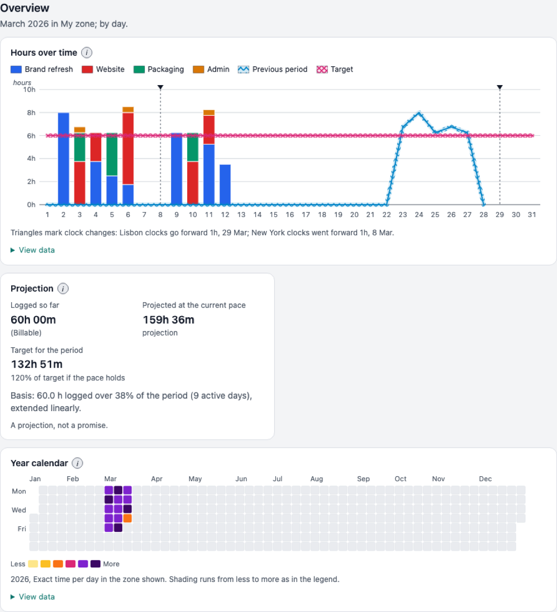

### Time zones, the map and Show both

Stored times are always UTC. Zones affect only display, grouping and exports. The header selector switches between **My time** (the default), **Client time**, **UTC** and **Other**, always labelled, for example "New York, EDT, UTC-4". Set your zone and the client's in **Settings**; a project can have its own client zone, used for that project's entry times in Show both.

The picker has a searchable list and an interactive world map. Click anywhere to select the zone there; an ocean click picks the nearest named zone. Zoom with the wheel or buttons. The list is the keyboard route.

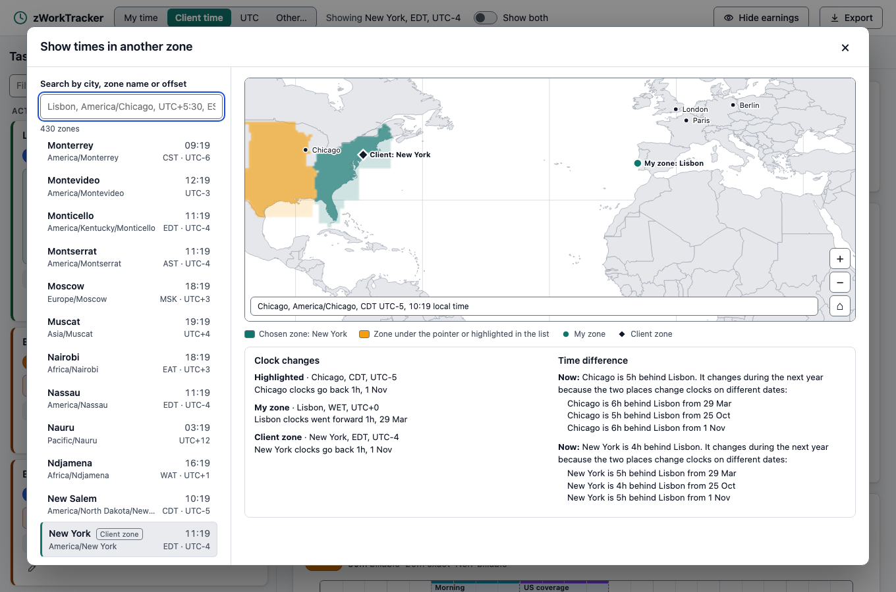

**Show both** adds a second axis for the client's zone on the same instants, and entries read "14:00-16:30 Lisbon / 09:00-11:30 New York". A marker shows where the zones' dates differ, and the client's working hours (default 09:00-17:00, set in Settings) are shaded with the overlap reported.

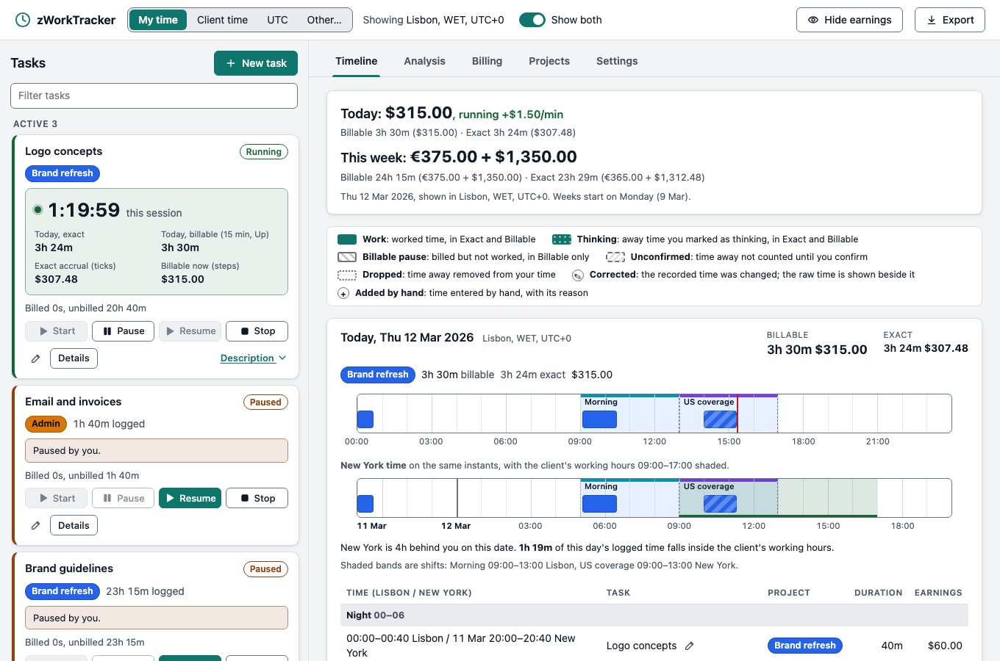

### Daylight saving and hour shifts

Every segment converts with the offset in force at that instant, never today's offset. So the same two zones can show different gaps in March and July, and the app says so for the date viewed ("New York is 4h behind you on this date").

- When a range contains a clock change, the Timeline axis and Analysis time charts mark it, for example "New York clocks went forward 1h, 8 Mar". Zones without DST show no marker.
- The picker shows the next change in each zone and warns about the weeks when US and EU dates differ.
- Day axes draw 23-hour and 25-hour days at their true length, and the repeated hour is labelled "01:00 again". Durations come from UTC, so a 25-hour day can total 25 hours.
- Hour charts bucket by wall-clock hour: both passes of a repeated hour land in one bucket, and a skipped hour stays empty.

Rust and the UI use one time zone database, generated at build time and shown in **Settings > About**. App updates carry time zone rule changes.

### Work shifts

In **Settings**, define your own shifts with a name, colour, start and end time, weekdays, zone and optional unpaid break. Morning, Afternoon and Night presets are provided and editable. Shifts crossing midnight work and belong to the date they start on. A shift follows its own zone's clock through DST, so a night shift can be 7h or 9h on a change night. To change a shift without rewriting past analysis, save a new version with a later effective date.

Shifts appear as background bands on the Timeline and have their own Analysis charts: scheduled versus worked, time outside any shift, late start and early finish, and client-hours coverage.

Each change to a shift is kept as a dated version. **Revert** removes one version after a confirmation that says which applies afterwards; a shift's only version can't be reverted, so retire or delete it instead.

**Attribution rule:** work is cut at shift boundaries. Where shifts overlap, the time goes to the one that started earliest, ties by shift id, so totals never double-count. **Overtime precedence:** shift-scheduled hours when shifts exist, otherwise the daily target.

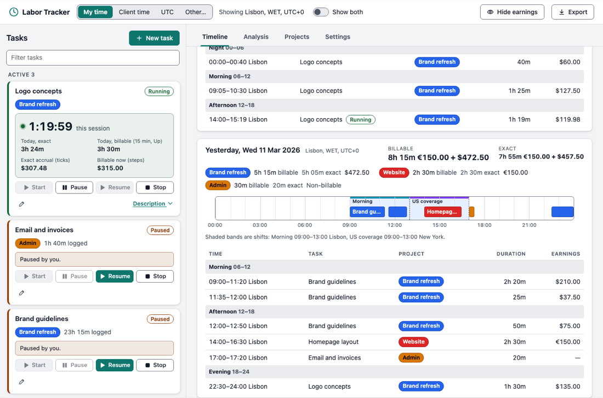

### Increments and rounding

The default is **15 minutes, rounding up**. Choices are Off (exact), 1, 5, 6, 10, 15, 30, 60 or a custom number of minutes, with Up, Nearest or Down. A project can override the setting.

- Raw UTC times are never rounded. Rounding is a calculation, reversible by changing the setting.
- The unit is **one task on one day** in the zone being viewed, rounded once. Many short pauses neither inflate nor erase time. Day, project and period totals are sums of the rounded rows.
- Up: 1 minute bills 15; exactly 15:00 stays 15:00; 15:01 bills 30:00. Timestamps are stored in whole seconds, so sub-second timer noise can't add an increment.
- Rows with no exact time stay at 0 and are flagged. Under Nearest or Down, a row that rounds to 0 is kept and flagged, not dropped.
- Nearest rounds exact halves up.
- A settings change applies from its effective date. Backdating needs confirmation.
- Continued tasks round separately, so a chain can round up more than once in a day. See [Tasks and subtasks](#tasks-and-subtasks).

Totals show **Billable (rounded)** and **Exact**. Exact totals are the same in every zone. Billable totals can differ, because days fall differently: a segment crossing midnight in one zone is two rows there and one elsewhere. Pauses stay excluded from Exact. The rounding adjustment metric shows what rounding adds.

### Corrections, manual entries and billable pauses

You can add a manual entry for time the app didn't log, correct a segment's start and end, or void a segment and bring it back. Each asks for a reason where it helps and warns about overlaps. Nothing destroys the original: the logged UTC times stay in the file, the correction sits beside them, and the audit trail lists every change with when, what and why. A running segment can't be corrected, and neither can time on a billing summary until that summary is voided.

A pause can be marked **billable** when you were still working, for example on a call. It counts in Billable and earnings, is rounded once together with that task-day's exact time, and is included in the rounding adjustment, but it never counts in Exact and is reported on its own. Time covered twice bills once: a pause never bills a span a segment or another pause already covers.

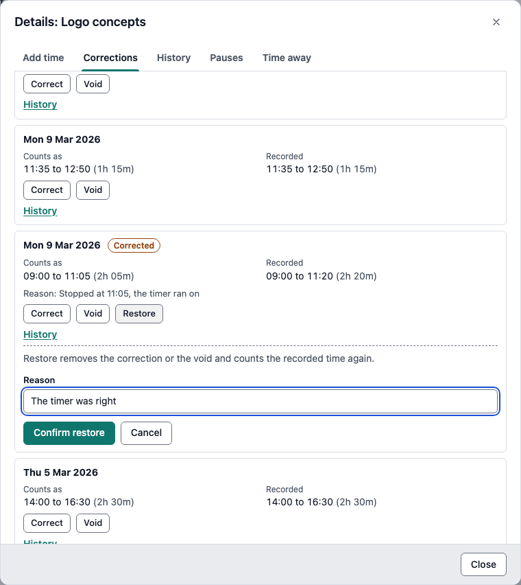

### Subtask time

A task-list item in a description can be made active. Exactly one is active at a time. Each segment belongs to the subtask active when it started; switching while running closes the segment and opens the next one, so task totals remain the sum of segments. Copying a task keeps subtask text, clears the ticks and carries no time. Removing the active item from the description clears the active subtask.

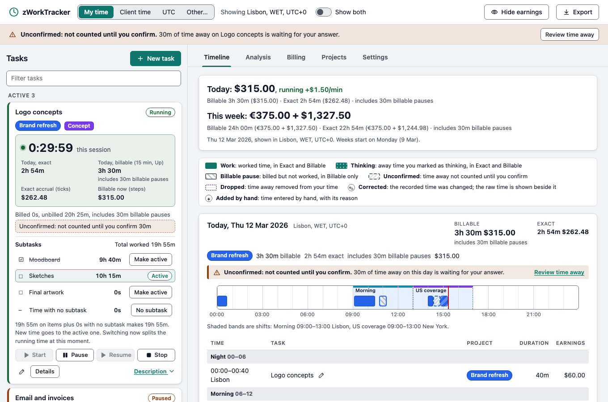

### Tags and templates

Tags have a name and a colour, and four starter tags come with the app. A warm start copies them; a cold start requires at least one, while any tag exists. Analysis breaks time down by tag. A template stores a task's name, description, project and tags, and creates an independent draft with unticked subtasks.

**New tag** next to the tag picker opens Settings at the Add tag form, focused. Tags aren't created inside the task form. **Back to task** stays up until you take it, and what you'd typed in the form is still there.

### Colours

Projects and tags share a colour picker: a saturation and brightness area, a hue slider, R, G and B fields from 0 to 255 and a hex field, all kept in step, with a live preview. It works by keyboard in every theme, and also offers curated swatches and your recently used colours. Any colour is allowed. Chip text picks black or white for readability, and you get a gentle warning, never a refusal, if a colour is close to another project's or hard to see on the current theme. The backend stores six-digit lowercase hex, such as `#1a2b3c`, and refuses anything else.

**One colour, one project.** Save a project with the exact colour of another active project and the app replaces it with a random colour that's clearly different from all active ones and readable in all four themes, then tells you, showing the new colour with a **Choose again** button. It never does this silently. Tags follow the same rule among tags. Archived projects don't count, and a colour you left unchanged is never replaced. Two PCs can choose the same colour while offline: after a sync both stay as saved, with a warning, because random choices on each PC would fight. The same generator supplies suggestions once the curated palette runs out.

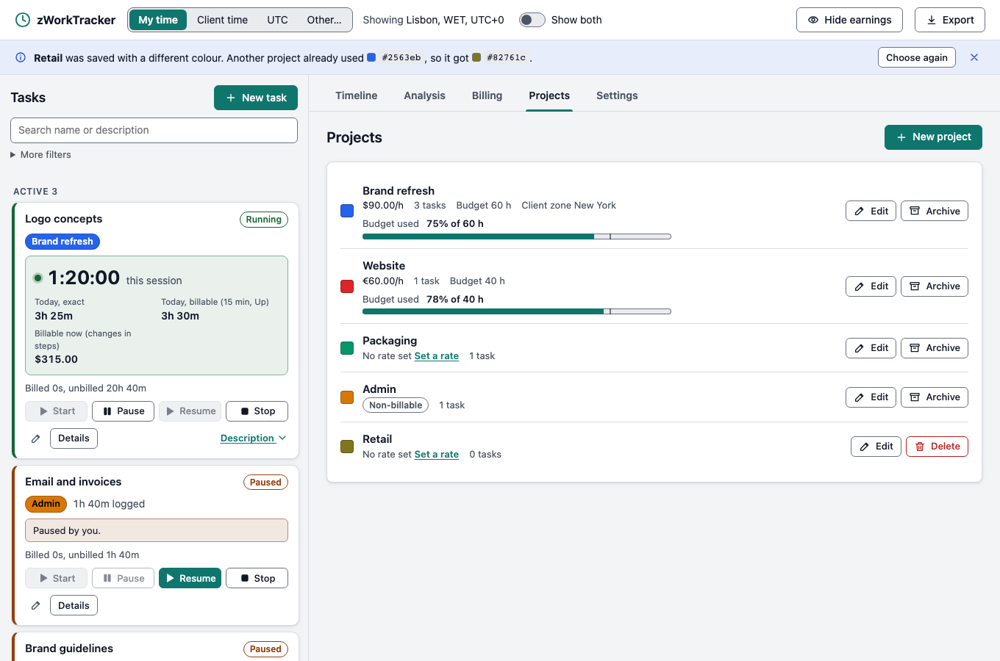

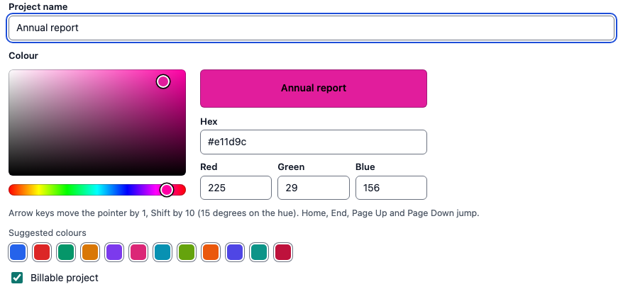

### Fixed-fee projects and budget alerts

A project bills **hourly** or at a **fixed fee** in EUR or USD. A fixed-fee project earns the fee, not time at a rate, so hourly earnings stay empty, and Analysis shows its effective hourly rate: the fee divided by billable hours. Budgets warn at 80% and 100%, of hours or of the fixed fee, on screen and once per threshold as a system notification. A fee-based budget values time using the project's rate as a target rate, and says so when none is set.

### Billing summaries

**This is for your own guidance. It is not an invoice and not a tax document, and says so on the page and in its exports.**

Pick a project and period to see unbilled closed time per task and day. **Create summary** freezes it into a summary with a reference such as `A-001` and marks that time billed. Tasks then show billed and unbilled time. Copy it or export it as CSV; with Hide earnings on, neither holds an amount. Voiding a summary puts the time back to unbilled; its number isn't reused.

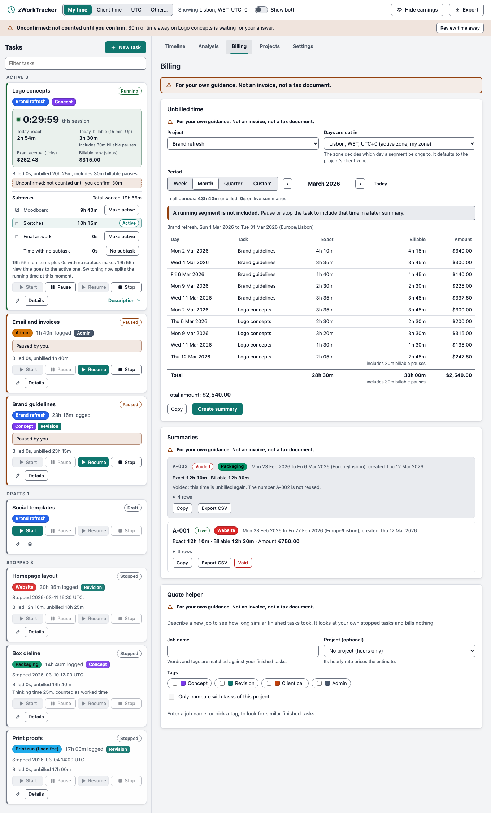

Each device has its own prefix, which you can edit. Numbers count up per prefix across all devices. Two devices offline at once could still pick the same prefix and reference, so the app warns when it finds a shared prefix or a repeated reference.

The preview tells you about time away you haven't answered yet. It's left out of the summary, and answering after that requires voiding the summary, so answer first. A partly billed task-day rounds again on its unbilled part, so it can round up twice. Time belongs to the day its segment started. A correction made on another device before the summary syncs still applies, while the frozen summary keeps its numbers.

### Timesheet PDF

A local PDF for a period, with or without prices, in the client's zone, with your logo (PNG) if you add one. It's built on this computer by a Rust library with no network access. It uses a built-in Latin font, so characters outside Windows-1252, such as Japanese or Greek, print as `?`. Only the Excel and CSV exports hold those characters as you typed them.

### Quote helper

Enter a job's name and tags to get an estimate from comparable past stopped tasks: a range and the number of tasks behind it. It's labelled as an estimate, and a low sample size is shown.

### Backups

The app writes a dated copy of its data once a day into a `backups` folder beside it, keeping the newest 30 by default; choose 1 to 365. These stay on this computer and are separate from sync. **Restore** in Settings first saves the current data as a safety copy, then rolls back your data and shared settings to the backup. The newest 5 safety copies are kept, apart from the daily ones. A running task pauses first, and the next start counts as cold. A task the backup held running is paused at the last moment that backup knows about. Restoring the safety copy undoes a restore. What belongs to this device stays: its preferences and sync folders, its reference prefix, the reference numbers already used, so none is ever reused, and the audit trail, which records the restore. With sync on, newer records in your sync folders merge back in at the next sync, so to go back in time for good, turn sync off first.

### Earnings and Hide earnings

Earnings are derived from segments, rates and rounding, and stored nowhere as truth. They use billable time when an increment is on. Amounts keep an exact value (rate in cents times seconds) and round half up to cents only at the total shown, so visible rows can differ from a total by a cent. If a rate changes within a task-day, the rounding difference goes to the last rate in force that day.

EUR and USD are never added together; totals sit side by side. There are no exchange-rate lookups.

**Hide earnings** in the header masks amounts everywhere, including the tray, and is remembered. Use it when a client may see the screen.

### Excel and CSV exports

**Export** asks for the format, day zone, your zone, the client's zone and whether to include earnings. Turn earnings off for a client-facing file: no price data appears anywhere in it.

The Excel workbook has these sheets:

1. **Labor by project:** exactly `Project | Day | Time | Task name | Subtasks`, sorted by project, day and start, one row per task per day. Time is billable time as a real `[h]:mm:ss` value that sums, Day is a real date, and Subtasks are the list items from the description with numbering kept. Subtotals and a grand total use formulas with cached values. The title line states the zone and increment. A project filter keeps its subtotal row.
2. **Segment details:** raw UTC start and end, your time, the client's time, Exact, Shift and, if included, rate, currency and exact amount.
3. **Earnings** (if included): per project and currency, with per-currency totals.
4. **Analytics:** KPI summary, Bands, Projects, Weekdays, Shifts when configured, and earnings sheets if included. These follow the last Analysis view, or all logged history if Analysis was never opened.

**Exporting a selection.** When entries are selected, the dialog's scope defaults to **Selected** instead of **All in period**. The backend gets only task ids and days, checks them, refuses an empty selection or an entry with no time, and recomputes everything itself, with rounding per task-day, so figures match the Timeline. Labor by project, Segment details, Earnings and Adjustments cover the selection only, with the first sheet's columns unchanged. The Analytics sheets are left out, since they describe the whole period, and a sheet named **About this selection** says what the file is. CSV ends with a `selection` row and the PDF timesheet prints a line saying the same. The selection clears after an export only if you ask.

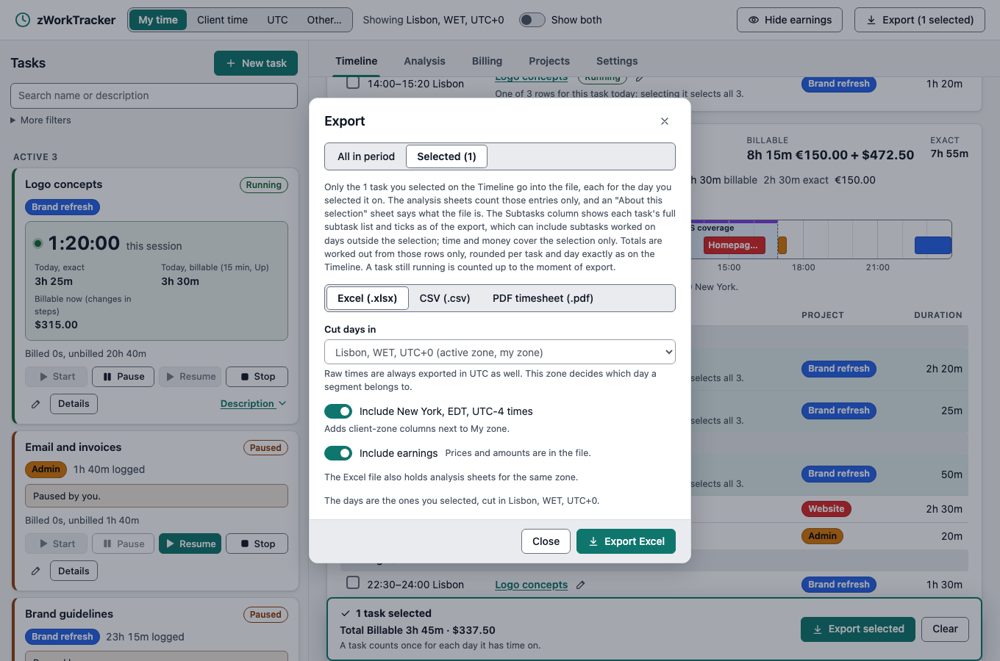

See [docs/sample-export.xlsx](docs/sample-export.xlsx) for a sample built from synthetic data.

CSV has `record_type` rows: `segment` rows carry raw UTC, zone times and exact durations; `task_day` rows carry billable time. Filter by that column before summing. User text is protected against spreadsheet formula injection in CSV, and is always written as plain strings in Excel.

### Themes

**Light** (default), **Solarized Light**, **Solarized Dark** and **Dark**, chosen in Settings per device. The OS theme isn't followed. Project colours stay as you chose them in every theme.

**Mica**, under Appearance, lets the Windows 11 backdrop show faintly through the page background in Light and Dark. Solarized stays opaque, and so do panels with text. It's off by default, and on anything older than Windows 11 the switch is disabled and says why. If Windows refuses the backdrop, the page stays opaque and the switch is disabled for that run. Windows can also accept it and draw a plain fill instead, for example with Transparency effects off. The app can't detect that, so about 10% of that fill shows through the page background. Panels with text stay opaque.

### Folder sync on OneDrive and Google Drive

The app stores everything locally first, and works offline. To sync, it uses the folders of the OneDrive or Google Drive desktop clients, which do the upload. The app itself makes no network calls.

- **Setup.** On first launch, and in Settings, detected folders are listed with checkboxes, plus **Choose another folder**. You can enable either or both. Nothing turns on silently. If nothing is detected, the screen explains that a desktop client is needed and offers the picker.
- **Second PC.** If a folder already holds `zWorkTracker/devices/`, the app previews the counts and offers to connect and merge.
- **When.** Once you've turned it on, it's automatic, with no further prompts: at launch, about 2 seconds after each major action (Start, Pause, Resume, Stop, or a change to a project, shift, rate or setting), about 15 seconds after a task's text was edited, every 30 minutes while the app runs, including hidden in the tray and during a running task, and at a real quit. A failed attempt retries after 30 seconds, 1 minute, 2 minutes and so on, up to every 15 minutes.
- **Changing the folder.** You can switch to another folder or provider at any time in Settings; see below.
- **Status.** Each folder shows its own status, such as "Written to OneDrive folder, 2 min ago". The app can't confirm the upload finished, so it only claims the write. A failing folder never affects another one, and never blocks time logging.

Each PC writes only its own file, `<folder>/zWorkTracker/devices/<device-uuid>.json`, and reads the others, so cloud clients have no shared file to fork into conflict copies.

**Merge rules, in plain language.**

- Projects, settings, shifts, rates and increments: the latest edit wins per record, ties settled by device id.
- Tasks merge per field. A name edited on one PC and a description edited on another both survive.
- Task state follows the same rule, except Stopped is final and always wins.
- Work segments are combined by id, and a closed copy beats an open copy.
- Deleted items leave a marker so they don't come back. Archives don't either. A draft deleted on one PC but started on another stays, because logged work is never hidden.
- Conflict copies and unknown files are ignored and never deleted. A damaged or newer-version file is skipped with a warning, and the last good data stays. A newer-version file is never overwritten.
- An unreadable OneDrive Files On-Demand placeholder is retried later and isn't treated as damage.
- If tasks run on two PCs at once, both are kept, a warning stays visible, and neither PC alters the other's segments. A task running on another PC can be stopped here, but its open segment is left for that PC to close. Until then it counts up to that PC's last known heartbeat. If the other PC seems stuck, **Pause it from here** records a synced, audited request. It never rewrites that device's segment: time counts up to the request on every PC, and the other PC closes its own segment when it next syncs, marked as paused by request.

Two projects created offline with the same name on two PCs stay as two projects.

**Changing the sync folder.** In Settings, choose **Change folder**, or add a second one. A preview shows the source, the destination and the counts in each. The app then:

1. Reads the previous folder's device files and merges them into local data by the rules above. If the new folder already has zWorkTracker data, that's merged too, not overwritten.
2. Copies the other devices' files across and writes this device's merged file. A fresher file already in the new folder is left alone. Conflict copies aren't copied, and damaged or newer-version files are skipped with a warning.
3. Reads the new folder back and compares counts and a content checksum before calling it done. Only then does the setting change.

The old folder is never changed or deleted: it just stops being written to, and you can remove it yourself. Time logging carries on during the copy. If a copy fails, the setting stays on the old folder and local data is unharmed, and running it again is safe. If the previous folder can't be read, for instance when it's offline or its client was removed, the move goes ahead from local data, says so, and offers **Retry copy** for later.

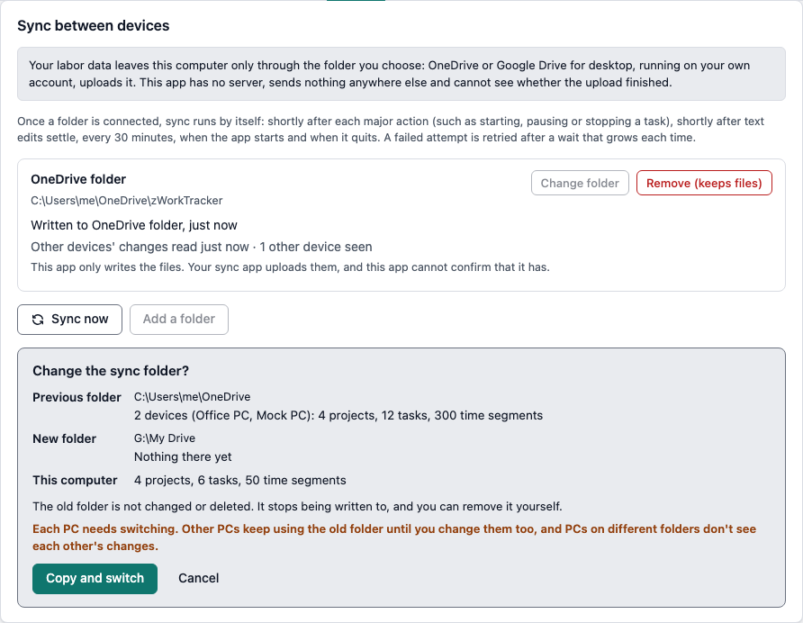

**Each PC needs switching.** Other PCs keep using the old folder until you change them too, and PCs on different folders don't see each other's changes.

**Keep the sync folder to yourself.** The files there are plain data, and whoever can write to that folder can change your hours and rates on every connected PC. The app rejects implausible files, such as impossible dates, oversized files or too many devices, but it can't tell a false entry from a real one. Don't use a folder shared with other people.

If a folder stops responding, the app reports it and moves on, and doesn't start more work on that folder until the stuck call returns. After restoring an older local data file, the app recovers what only its own sync file still holds.

## Metrics reference

The full list with formulas is in the app's searchable Metrics glossary (source: `src/features/analysis/glossary.ts`). Each entry states which time it uses.

| Uses | Metrics |
|---|---|
| **Exact** | Time of day, hour histogram, weekday by hour heatmap, year calendar, sessions and session length, longest stretch, pauses, focus ratio, context switches, fragmentation, typical start and finish, working span, shift attainment and coverage |
| **Billable** | Project totals and shares, hours over time, billable hours and share, budget burn, earnings, effective hourly rate, rounding adjustment (billable minus exact), projection |

Definitions worth knowing:

- **A pause** is the gap between two consecutive segments of the same task, or from a task's last segment to its Stop, that begins and ends on the same calendar day in the zone you're viewing. Gaps crossing midnight, such as overnight or weekend breaks, aren't pauses and are excluded from every figure. A pause belongs to the day it began, and a still-paused task's open gap isn't counted. Pauses of different tasks add up, so a day can show more paused time than worked time.
- **Exact** leaves out time away that's unanswered or dropped, and billable pauses. **Billable** adds billable pauses and rounds once per task-day. The **rounding adjustment** is Billable minus Exact, with billable pauses shown separately. Thinking counts in both, shown separately.
- **Effective hourly rate** on a fixed-fee project is the fee divided by Billable hours. **Billed** and **unbilled** seconds are the time on and off a live billing summary. Tag analytics count a task's time under each of its tags, so tag totals can add up to more than the total.
- A band or shift filter hides Billable figures, because rounding works on whole task-days.
- Client working hours apply Monday to Friday.
- A forecast is a straight-line projection and needs 7 or more days, 20% of the period elapsed and 2 active days. Budget pace uses the last 28 days.
- Figures with too little data show "Not enough data".

## Data and privacy

| | |
|---|---|
| **Windows** | `%APPDATA%\com.rustcircle.zworktracker\` |
| **macOS** | `~/Library/Application Support/com.rustcircle.zworktracker/` |
| **Main file** | `z-work-data.json`: versioned JSON with timestamps in UTC (`2026-03-08T07:00:00Z`) |
| **Backup** | `z-work-data.json.bak`: the previous good version |
| **Drafts** | `z-work-drafts.json`: descriptions being typed, local only, recovered once at launch |
| **Heartbeat** | `z-work-heartbeat.json`: while a task runs, the last moment the app was alive. It holds one time |
| **Dated backups** | `backups/`: one copy a day, plus safety copies made before a restore |
| **Before a migration** | `z-work-data.v1.json`: the store as it was before an upgrade |
| **Damaged files** | Kept as `z-work-data.corrupt-<time>.json` |

Saves are atomic: a temporary file, then a rename. If the main file is damaged the app restores from the backup and tells you. If both are damaged it keeps both copies, starts empty and says so. A file from a newer app version is refused and left untouched. Data is never silently wiped.

**What leaves the machine:** nothing, except through your own sync folder. Those files hold your full labor data, including prices, unencrypted. There's no telemetry, and the build contains no HTTP or TLS library; a test enforces this.

## Developer guide

### Prerequisites

- Node 24 (`.nvmrc` and `engines` in `package.json`; CI reads the same file) and pnpm, whose version `packageManager` pins
- rustup. The toolchain is pinned in `rust-toolchain.toml` (stable, with the `x86_64-pc-windows-gnu` target) and installs itself on first use. You don't need a global default.
- On macOS, Xcode command line tools. To build for Windows: `brew install mingw-w64 nsis`

### Install and run

```sh
pnpm install
pnpm exec playwright install chromium   # only for e2e tests
pnpm tauri dev
```

### Tests

```sh
pnpm exec tsc --noEmit                  # types
pnpm exec eslint . --max-warnings 0     # lint
pnpm exec vitest run                    # unit and component tests
pnpm test:perf                          # 50k-segment timings
pnpm exec playwright test               # e2e against the IPC mock, under the real CSP; ZWT_SHOT_DIR=<folder> saves screenshots there
pnpm smoke:native                       # real macOS builds: real webview, IPC and files

cd src-tauri
cargo fmt --all --check
cargo clippy --workspace --all-targets -- -D warnings
cargo test --workspace
cargo check -p z-work-core --tests --locked --target x86_64-pc-windows-gnu        # test code compiles for Windows
cargo clippy --workspace --all-targets --target x86_64-pc-windows-gnu -- -D warnings

# Read a sample selection back, and scan the raw file for anything unselected
ZWT_SAMPLE_SELECTION_XLSX=/tmp/sel.xlsx cargo test --manifest-path src-tauri/Cargo.toml -p z-work-core the_workbook_builds
uv run --no-project --with openpyxl scripts/verify_selection.py /tmp/sel.xlsx
# Read a sample Excel file back with an independent reader
ZWT_SAMPLE_XLSX=/tmp/sample.xlsx cargo test -p z-work-core builds_with_earnings
cd .. && uv run --no-project --with openpyxl scripts/verify_xlsx.py /tmp/sample.xlsx
```

Continuous integration: `.github/workflows/ci.yml` runs these gates on `windows-latest` on each push to `main` and each pull request into `main`, and can be started by hand. Playwright there runs against the IPC mock, so it doesn't drive the real backend, and a green run says nothing about the installer or the app on a real desktop. A small macOS job runs the core's lint and tests, for its Unix-only file handling. It uses no secrets and signs nothing. Packaging runs only in `windows-build.yml`, by hand or on a tag. The timing test is too noisy for a shared runner, so run it locally.

`pnpm gen:tz` regenerates `src/generated/tzdata.json` from Rust's time zone database. Run it after updating `chrono-tz`.

### Architecture

The state machine, persistence, recovery, merge, rounding, earnings and exports are in a Rust crate with no Tauri dependency and an injected clock. A thin Tauri shell adds commands, tray, heartbeat and the sync thread, so timing doesn't depend on the window being visible. The UI receives a full snapshot after every change and computes display figures in pure TS modules.

```
src-tauri/
  crates/z-work-core/src/   Pure core
    machine.rs             Task state machine, projects, shifts, rates
    model.rs               Persisted and synced data model
    persist.rs             Atomic save, backup, recovery, migrations
    merge.rs               Deterministic merge between devices
    sync.rs, detect.rs     Folder sync, sync folder detection
    billing.rs             Day splitting, rounding, earnings
    report.rs, csv.rs, xlsx.rs, subtasks.rs   Exports
    tray.rs                Close-versus-quit decision, tray content
    service.rs, view.rs    Transactions, the UI's snapshot
  src/lib.rs               Tauri shell
  windows/                 NSIS hooks and strings
src/
  lib/                     tz engine, band splitting, billing, shifts, colour, themes, API
  app/store.tsx            Snapshot, clock, zones
  components/              Shell and shared UI
  features/                tasks, projects, timeline, settings, export, analysis, zones
  mocks/                   IPC mock and demo seed, for tests only
  generated/tzdata.json    Generated from Rust's tz database
fixtures/                  Tests shared by Rust and TS, so they can't drift
e2e/                       Playwright specs
scripts/                   Native smoke, Excel check, packaging, signing
```

Billing and time zone rules exist in both Rust (for exports and the tray) and TS (for the live UI). `fixtures/*.json` runs against both.

### Data model and schema migration

Two versions exist: `version` in the local file and `schemaVersion` in device files, both 2. Opening a version 1 store keeps a copy as `z-work-data.v1.json`, then upgrades it; a test reads a real phase 1 file. To change the schema, raise `SCHEMA_VERSION` and add a step to `migrate()` in `persist.rs`. Optional fields need no step, because every synced record defaults missing ones. An old build skips a newer device file, warns "Update this device" and never overwrites it. Task lists from version 1 get subtask ids derived from the task id and position, so every device derives the same ones without a new edit stamp.

The synced state is a set of records with stable ids, merged by taking the maximum under a total order. Property tests check that the merge is idempotent, commutative and associative, for time away, billable pauses, tags, templates, summaries, prefixes and the audit log too. Corrections, time away and billable pauses are overlays on raw segments, and `pieces.rs` turns them into the pieces every report reads. A synced file is untrusted: `validate.rs` refuses out-of-range times, amounts and references before a merge.

### Security model

- Strict CSP in `tauri.conf.json`: no inline scripts or styles, no remote content. E2e tests run under that same CSP and fail on any violation.
- Minimal capabilities: the window can only listen for backend events. No shell or filesystem plugin. The save and folder dialogs run from Rust.
- Every command input is validated in Rust. Descriptions are allow-listed to known nodes and rendered only through the editor; ESLint rejects raw HTML injection.
- Files from sync folders are untrusted: they are limited in size and count, schema-checked and checked for plausible times, durations and settings, and rejected files are skipped. Each folder runs on its own worker with a time limit. Validation doesn't authenticate the writer; see [Folder sync](#folder-sync-on-onedrive-and-google-drive).
- A save re-reads what it is about to write and refuses it if it wouldn't load, so a bad value can't replace a good store.
- `unsafe` is forbidden in this project's crates, and clippy warns on `unwrap`, `expect`, `panic` and indexing.
- The test-only `smoke` feature (data folder override, extra commands) is never enabled in shipped builds. The demo seed and IPC mock are absent from the production bundle.

### Git workflow

Work happens on feature branches in small commits that end with the co-author line, and `main` is the published branch on GitHub. Merging and pushing are the owner's call. Lockfiles are tracked.

## Performance

Measured on an Apple M3 Ultra on AC power, with a synthetic store of 12 projects, 400 tasks and three years. 50,000 segments is about 13 years at 10 segments a day, so it's a stress size; 5,000 is the more likely one. **All numbers are macOS.** A typical Windows laptop will be several times slower. WebView2, NTFS and antivirus are the most likely to change the picture, above all cold start, the cost of a disk flush, and what a hidden webview does. Nothing here was measured on Windows.

| | 5,000 segments, before → after | 50,000 segments, before → after |
|---|---|---|
| Cold start to first render, real app | 573 → 490 ms | 1,262 → 832 ms |
| Save after one action | 61 → 44 ms | 249 → 107 ms |
| Heartbeat, every 30 s with a task running | 60 → 13 ms | 252 → 15 ms |
| Disk written per heartbeat, with one store copy to `.bak` on the first beat after a save | 4 MB → 79 bytes | 32 MB → 79 bytes |
| Opening the store | 81 → 9 ms | 383 → 61 ms |
| Building and encoding a snapshot | 18 → 10 ms | 169 → 85 ms |
| Sync cycle with three other devices, nothing new | 150 → 70 ms | 916 → 319 ms |

With a task running and the window hidden, the real app at 50,000 segments used 8.4% of one core before and about 1% after, across all its processes, in the first minutes. WebKit suspends a hidden page after about five minutes, and from then on the main process goes from 2.5% to 0.4% and from 17 to 0.3 idle wakeups a second.

In headless Chromium against the IPC mock, at 50,000 segments, script time a second with a task running goes from 15 to 6 ms on Timeline and from 31 to 6 ms on Analysis with a year selected, and is 0 while hidden. Chromium isn't the app's webview, so these show how the page behaves, not what a user's machine will do. Showing every chart for three years takes about 100 ms the first time and 40 ms after. 200 rounds of tab and range switches grow the JS heap by 2 MB in total, with DOM nodes and listeners flat.

Left alone because measuring showed no case for a change:

- **Lazy-loading TipTap.** Removing it altogether, a 405 KB saving, takes 14 ms off a 569 ms cold start, and the chunk would still ship. Charts would gain no more. The map is already lazy, and its first open takes 415 ms.
- **Exports.** At 50,000 segments Excel takes 0.95 s and PDF 0.15 s, on a request and off the UI thread.
- **`opt-level = 3`.** About 10% faster for most of the backend, for a 23% bigger binary.
- **`panic = "abort"`.** 23% smaller, but a panic in a helper thread would take the app down, where today it survives.
- **The whole store as JSON.** A save still serialises everything, 16 MB at 50,000 segments, and every action still sends the page a 30 MB snapshot. The cost is linear and acceptable at any likely size. Memory follows the same line, with the webview near 800 MB at 50,000 segments and near 180 MB at 5,000. Changing this means a different storage format and IPC shape.

To repeat the measurements:

```sh
cd src-tauri && cargo run --release -p z-work-core --example perf_bench -- 50000 out.json   # also prints digests of every output
pnpm build:e2e && node scripts/perf-frontend.mjs --out out.json                             # headless Chromium against the mock
CARGO_TARGET_DIR=<dir> pnpm tauri build --no-bundle --features smoke
node scripts/perf-native.mjs --exe <dir>/release/zWorkTracker --store <store> --out out.json # real app; needs the display on and the window not covered
```

`perf_bench write-store <dir> <segments> paused` makes such a store. A native run is only valid with the display on, because macOS stops drawing a covered window or one on a sleeping display.

## Packaging and signing

### Windows installer from macOS

```sh
pnpm package:windows
```

This builds with the GNU toolchain and writes `src-tauri/target/x86_64-pc-windows-gnu/release/bundle/nsis/zWorkTracker_0.1.0_x64-setup.exe`. It then lists the exe's imports in `pe-imports.txt`, fails if a compiler runtime DLL is needed, and reports whether the files are signed. `WebView2Loader.dll` ships inside the installer next to the exe.

### Trusting your own builds with a self-signed certificate

This is only for your own PCs. A self-signed certificate is trusted only on PCs set up as below. It isn't public code signing and must not be described as signed for anyone else. **The private key must stay private**: the commands make it non-exportable, on the PC that signs. Norton and other security tools may still flag the file. These commands haven't been run for this project, because it has no Windows machine to test on.

In Windows PowerShell, on the PC that signs:

```powershell
$cert = New-SelfSignedCertificate -Type CodeSigningCert -Subject "CN=Pedro Jorge (zWorkTracker)" `
  -CertStoreLocation Cert:\CurrentUser\My -KeyExportPolicy NonExportable -KeyUsage DigitalSignature `
  -NotAfter (Get-Date).AddYears(3)
Export-Certificate -Cert $cert -FilePath .\zWorkTracker-public.cer
```

On each PC that should trust it, signing PC included, import the public `.cer` only. Windows asks you to confirm the Root import:

```powershell
Import-Certificate -FilePath .\zWorkTracker-public.cer -CertStoreLocation Cert:\CurrentUser\Root
Import-Certificate -FilePath .\zWorkTracker-public.cer -CertStoreLocation Cert:\CurrentUser\TrustedPublisher
```

Sign both the installer and, once installed, the installed `zWorkTracker.exe`, adjusting the paths to yours. A timestamp keeps the signature valid after the certificate expires:

```powershell
$cert = Get-ChildItem Cert:\CurrentUser\My -CodeSigningCert | Where-Object Subject -eq "CN=Pedro Jorge (zWorkTracker)"
Set-AuthenticodeSignature -FilePath .\zWorkTracker_0.1.0_x64-setup.exe -Certificate $cert -HashAlgorithm SHA256 -TimestampServer http://timestamp.digicert.com
Set-AuthenticodeSignature -FilePath "$env:LOCALAPPDATA\zWorkTracker\zWorkTracker.exe" -Certificate $cert -HashAlgorithm SHA256 -TimestampServer http://timestamp.digicert.com
Get-AuthenticodeSignature .\zWorkTracker_0.1.0_x64-setup.exe, "$env:LOCALAPPDATA\zWorkTracker\zWorkTracker.exe" | Format-List Status, StatusMessage, SignerCertificate
```

`Status` should read `Valid` on a PC set up this way. Reinstalling replaces the installed exe with an unsigned copy, so sign it again afterwards.

**If Norton flags it.** Don't add exclusions. Report it as a false positive through Norton's route: <https://support.norton.com/sp/en/us/home/current/solutions/kb20090410134005EN>.

### Windows installer from GitHub

`.github/workflows/windows-build.yml` builds on `windows-latest`, by manual run or a `v*` tag. That build uses Rust's MSVC target, and the build from macOS uses MinGW; the bundling config is the same, but only the MinGW build has been produced so far. It hasn't been pushed or run yet.

### Windows code signing

The artifacts are **unsigned** until you add credentials. No certificate is included, and none is created. Signing runs through `bundle.windows.signCommand` for the exe, the installer, the uninstaller and the bundled DLLs. It always uses SHA-256 with an RFC 3161 timestamp. With no credentials the build prints `UNSIGNED` and succeeds. Partly set credentials fail the build, so a release isn't silently unsigned.

**First, check the metadata.** In `src-tauri/tauri.conf.json`, `bundle.publisher` is what Installed Apps shows, and `bundle.copyright` names the copyright holder. With your own certificate, keep the publisher the same as the name on it. The name Windows shows in security prompts always comes from the certificate.

**Route 1: Azure Artifact Signing (formerly Trusted Signing), recommended.**

1. Create an Artifact Signing account, an identity validation and a certificate profile in Azure.
2. Create an app registration and give it the signer role on the profile.
3. Install the tool on the build machine: `cargo install trusted-signing-cli`
4. Set the variables listed in `.env.example`: `AZURE_SIGNING_ENDPOINT`, `AZURE_SIGNING_ACCOUNT`, `AZURE_SIGNING_PROFILE`, `AZURE_TENANT_ID`, `AZURE_CLIENT_ID`, `AZURE_CLIENT_SECRET`.

**Route 2: your own certificate.**

- On Windows, use a certificate in the store with `WINDOWS_CERT_THUMBPRINT`, or a PFX with `WINDOWS_CERT_PFX_PATH` and `WINDOWS_CERT_PASSWORD`, through signtool.
- From macOS, `brew install osslsigncode` and use the PFX variables.
- `WINDOWS_TIMESTAMP_URL` is optional.

**Route 3: SignPath Foundation, free for open source (if the project is accepted).** Acceptance isn't assured, and the routes above and unsigned builds keep working regardless. **The publisher Windows shows will be "SignPath Foundation", not you.**

1. Set the repository variable `SIGNING_ROUTE` to `signpath`. This selects the workflow's `signpath` job; the `build` job then skips.
2. Add the secret `SIGNPATH_API_TOKEN`, and the variables `SIGNPATH_ORGANIZATION_ID` and `SIGNPATH_CONNECTOR_URL`.
3. In SignPath, create project `z-work-tracker`, policy `release-signing` with manual approval, and artifact configurations `exe` and `installer`.

The job runs only on a GitHub-hosted Windows runner, because SignPath won't sign what's built elsewhere, so the installer built from macOS can't take this route. It signs the exe, packs it into the installer with `makensis`, signs the installer, then verifies both with `signtool verify /pa`. That's two approvals per release. The uninstaller embedded in the installer stays unsigned on this route. None of this has run yet.

**On GitHub,** add the same names as repository secrets, with the PFX as base64 in `WINDOWS_CERT_PFX_BASE64`. The workflow runs `signtool verify /pa` and fails if credentials were supplied but verification fails.

Never commit real values. `.env` is ignored by git. Note that scripts read variables from the environment, so export them or load `.env` first. Signing routes have been tested for command construction and secret handling, not with a real certificate.

### Manual Windows test checklist

None of this has been run yet. Please check on a real Windows 11 PC:

- [ ] WebView2 is present and the app opens. With WebView2 disabled, a clear message appears, not a blank window
- [ ] The installer runs without admin rights; SmartScreen behaves as described
- [ ] Start Menu shortcut, optional desktop shortcut and launch on finish work
- [ ] Listed in Installed apps with name, version, publisher and icon
- [ ] Start, Pause, Resume and Stop work, with auto-pause on another task
- [ ] X hides to the tray with the one-time notice; a running task keeps timing
- [ ] Tray left-click, menu, tooltip and running icon work; Pause/Resume from the tray work
- [ ] Tray Quit closes the segment and marks the task paused
- [ ] Windows shutdown or sign-out with a running task loses at most the last 30 seconds
- [ ] A second launch shows the existing window and stays warm
- [ ] After tray Quit and reopening: the form is empty and all fields are required; Resume opens the form; tray Resume opens the window with the form and starts nothing
- [ ] Task Manager kill, then relaunch: crash notice appears
- [ ] Time zone display matches a known clock; a client zone and the map work
- [ ] OneDrive and Google Drive folders (Stream and Mirror) are detected, and sync works between two PCs
- [ ] Excel export opens in Excel with working totals; save dialogs work
- [ ] Start with Windows works
- [ ] Upgrade keeps data, and closes a running app cleanly
- [ ] Uninstall removes files, shortcuts and the autostart entry; unticked keeps data, ticked deletes it; sync folders are untouched

## Troubleshooting

| Problem | What to do |
|---|---|
| "Windows protected your PC" | The installer is unsigned. Choose **More info**, then **Run anyway**. |
| Blank window or WebView2 message | Run Windows Update, or reinstall the WebView2 Runtime from Microsoft. Your data is safe. |
| The app seems gone after closing | It's in the tray; check the overflow arrow. Only tray **Quit** exits. |
| Time kept running overnight | The app asks about a sleep or idle time when you return, and it counts nowhere until you answer. Answer **Drop**, or correct the segment. |
| A summary won't let me answer about time away | That segment is on a billing summary. Void the summary, answer, then create it again. |
| A PDF shows `?` | The PDF's built-in font covers Latin text only. Use the Excel or CSV export for other scripts. |
| Sync folder not detected | Use **Choose another folder**. Only common "My Drive" language variants are detected. |
| A sync folder shows an error | Check the desktop client is running and the drive is connected. Local data and other folders are unaffected. |
| "Written to folder" but another PC has no data | The desktop client may still be uploading. |
| "newer version" warning | Update the app on this device. |
| A restored-data notice | The previous file was damaged. The damaged copy is kept in the data folder. |
| Focus ratio looks low | It counts same-day gaps between sessions of each task, added across tasks. See [Metrics reference](#metrics-reference). |
| Earnings show "No rate set" | Set a price per hour on the project. |

## Known limitations

**Not verified on real Windows.** The only thing to run on Windows so far is a CI run of phase 1's test gates. The app itself has never run there. That includes the installer, uninstaller and hooks, tray, WebView2 check, `--quit` during install, autostart, sync folder detection, Windows file-lock handling, signing, Segoe UI rendering and shutdown handling. See the [checklist](#manual-windows-test-checklist).

**Verified only on macOS or against a mock.**

- Every phase 2 screen is tested against the mock, which reimplements the backend's rules in TypeScript and can drift from them. The native smoke script runs time away, manual entries, corrections, billing, the PDF, tag colours and backup restore against the real backend by calling its commands, without clicking those screens. The real file dialogs and clipboard weren't exercised.
- Warm copy, cold form, cold Resume and inline editing UI are tested against the mock. The native smoke script checks the backend rules and the tray route against the real backend.
- Real backend, webview and exit paths were tested on macOS with the native smoke script, which doesn't click the real tray icon. Tray icon appearance is unverified.
- The real OneDrive and Google Drive clients have not been exercised. Detection is tested with an injected environment.
- Most UI flows are tested with Playwright against the IPC mock.

**Not done.**

- OS shutdown relies on the app's exit event, which is unverified on Windows; if it doesn't fire, heartbeat recovery closes the segment within about 30 seconds of the real time.
- Mica has never been seen on Windows 11: the code is only compile-checked for Windows, and the tests prove the colours and contrast, not the look. It's optional and off by default, and it applies to Light and Dark only.
- Google Drive detection reads DriveFS's registry settings first, then scans drive letters and common folder names. The registry key names come from public descriptions and haven't been checked against a real install; if they're wrong, the scan and the picker still work.
- macOS gets no lock signal. Windows is the target, and this wasn't small enough to be worth the risk.
- The lock signal (`WTSQuerySessionInformationW`) has not been seen answering on a real locked Windows session; its logic is tested with injected events. On macOS there is no lock signal, so locks are noticed only through idle time.
- Idle reading (`user-idle`) has not run on Windows. After a wake it could report idle time spanning the sleep; the code clamps that, tested with injected values only.
- The reminder and budget notifications come from the system's notification service, not run on Windows.
- A restore with sync on merges newer records back, and the app warns about that.
- The PDF prints characters outside Windows-1252 as `?`.
- A correction made on another device before a summary syncs lands on billed time; the summary keeps its frozen numbers.
- Description edits on an existing task are stashed in a small local file about 300 ms after each change, and recovered at the next launch, once, with a notice, if newer than what was saved. The new-task form isn't covered, and nothing typed in the last 300 ms is.
- Map zone boundaries are approximate near borders, and the highlight is clipped to country outlines. The list is the exact choice.
- Time zone rules run from 2000 to 2045; earlier times use the first known offset.
- Rate is fixed to the task's current project: moving a task to another project re-derives its earnings from that project's rates.

## Roadmap

The approved phase 2 list is built, and is described in the [User guide](#user-guide). The performance pass is done; see [Performance](#performance). The gap-fill round is done apart from these: full Unicode in the PDF (it needs a bundled font, which hasn't been chosen or downloaded, so characters outside Windows-1252 still print as `?`) and the macOS lock signal.

## Third-party data licences

| Data or package | Licence | Used for |
|---|---|---|
| [timezone-boundary-builder](https://github.com/evansiroky/timezone-boundary-builder), through `@photostructure/tz-lookup` | Package: CC0-1.0. Boundary data derives from OpenStreetMap, © OpenStreetMap contributors, ODbL | Click on the map to get a zone. Shown in **Settings > About**. |
| [Natural Earth](https://www.naturalearthdata.com/), through `world-atlas` | Public domain; package: ISC | Country outlines on the map |
| `topojson-client` | ISC | Reading the outlines |
| IANA Time Zone Database, through `chrono-tz` | Public domain | Time zone rules |

The map shows outlines for orientation only and takes no position on borders, names or status.

The full list of components, including a note on the ODbL data behind the map lookup, is in [THIRD_PARTY_NOTICES.md](THIRD_PARTY_NOTICES.md).

## Code signing policy

**No release has been signed yet.** If SignPath Foundation accepts the project: free code signing provided by [SignPath.io](https://about.signpath.io/), certificate by [SignPath Foundation](https://signpath.org/), and Windows will show "SignPath Foundation" as the publisher.

- **Team:** Authors, Reviewers and Approvers are named in [docs/code-signing-policy.md](docs/code-signing-policy.md).
- **Approval:** every signing request, and so every release, needs manual approval by an Approver.
- **Accounts:** multi-factor authentication is required for all team members.
- **Builds:** only builds by this repository's workflow on GitHub-hosted runners are submitted.
- **Privacy:** this program makes no network calls and sends no telemetry. Data leaves your computer only through a OneDrive or Google Drive folder you choose, uploaded by that service's own desktop client.
- **Contact:** p@rustcircle.com

## Licence

[MIT](LICENSE).
